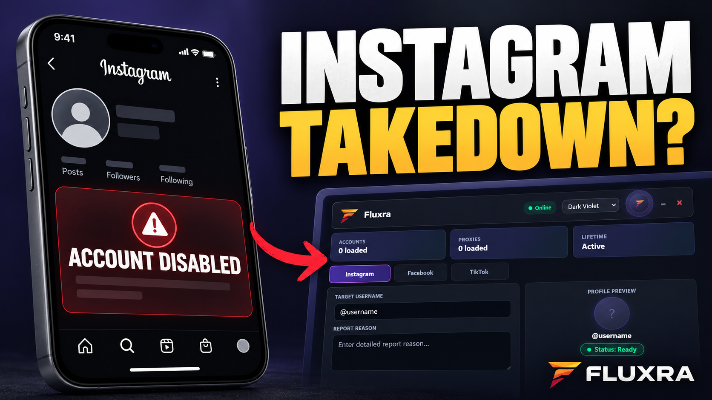
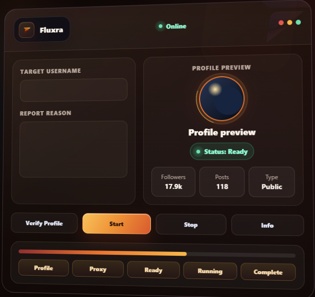

# Fluxra

### Instagram mass report tool and account takedown

Review profiles, organize report context, and follow activity in one private-access workspace.

---

## Watch the showcase

Click the thumbnail to watch the Fluxra showcase on YouTube.

## Product preview

## What Fluxra includes

| Feature | Purpose |
| --- | --- |
| Profile review | Inspect a target profile and keep the relevant context together. |
| Reporting workspace | Enter a report reason and manage the accounts and proxies used in a session. |
| Activity log | Follow session status, progress, and messages from the dashboard. |
| Browser access | Sign in to the web panel with a private license key, with no installation required. |
| Support | Get access details, setup help, and product updates through Telegram. |

## Get access

1. Visit [fluxra.tech](https://fluxra.tech/) to explore the product.
2. Contact [Fluxra on Telegram](https://t.me/Fluxra2) for availability and access details.
3. Once you have a license key, open the [web panel](https://fluxra.tech/tool) and sign in.

Access is private. This repository showcases the product; it does not distribute license keys.

## Responsible use

Use Fluxra only for lawful, good-faith reporting of genuine issues such as scams, impersonation, or harassment. Do not use it for false reports, spam, retaliation, or other abuse. Platform operators make their own enforcement decisions; Fluxra is independent and is not affiliated with or endorsed by Instagram or Meta.

## Links

- [Official website](https://fluxra.tech/)
- [Web panel](https://fluxra.tech/tool)
- [Telegram access and support](https://t.me/Fluxra2)
- [YouTube showcase](https://youtu.be/dI8NBW0JaJ4)

---

**Last updated: 2026-10-29 01:24 UTC**

